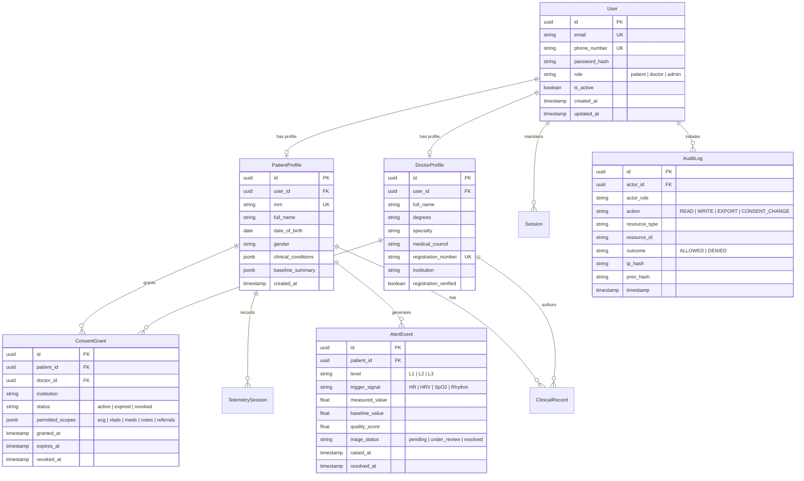

# CardioCoreEdge — Data Model & Telemetry Ingestion Architecture

**Document:** `docs/data-model-and-telemetry.md`  
**Phase:** Phase 6 — Backend Foundation and Security Architecture  
**Date:** 13 October 2026  
**Status:** Approved Design Specification  

---

## 1. Relational Data Model (Transactional & Clinical Metadata)

All relational entities, user credentials, patient profiles, consent grants, and clinical records are modeled using **SQLAlchemy 2.0 (asyncio)** targeting PostgreSQL.



---

## 2. Storage Tier Selection & Trade-Off Analysis

A multi-model polyglot persistence architecture is required to satisfy conflicting requirements of ACID transactional integrity, high-throughput time-series ingest, and sub-millisecond session validation:

| Storage Engine | Production Role | Data Housed | Rationale & Trade-Offs |
| :--- | :--- | :--- | :--- |
| **PostgreSQL 16+** | Relational / ACID Store | Users, Patient Profiles, Doctor Profiles, Consent Grants, Audit Logs, Prescriptions | **Pros:** Strong consistency, foreign keys, row-level security (RLS), JSONB indexing.<br>**Cons:** Unsuitable for sustained 250 Hz sample-by-sample ingestion. |
| **TimescaleDB / ClickHouse** | Time-Series Hypertable | 250 Hz Lead-I ECG raw chunks, 1 Hz PPG/SpO2, derived 5-min HRV metrics | **Pros:** Columnar compression (80–90% reduction), chunked partitioning by time, vectorized aggregations.<br>**Cons:** Complex schema migrations, eventual consistency for analytic replicas. |
| **Redis 7+ (Cluster)** | In-Memory Cache & Buffer | User Session states, CSRF tokens, OTP rate-limit buckets, ingest buffer queue | **Pros:** Sub-millisecond latency, automatic TTL expiration, pub/sub for real-time WebSocket fan-out.<br>**Cons:** Ephemeral; requires persistence snapshots (AOF/RDB) to prevent logout storms on restart. |
| **S3 / MinIO Object Store** | Cold Archive | Anonymized 30-day raw waveform Parquet files, exported clinical PDF summaries | **Pros:** Extreme cost efficiency ($0.02/GB/mo), immutable WORM compliance for medical records.<br>**Cons:** High latency for random sample lookups (must fetch full chunk). |

---

## 3. High-Frequency Telemetry: 250 Hz Lead-I ECG Architecture

### 3.1 Mathematical Volume & Retention Sizing

#### Assumptions:
1. **Sampling Frequency ($f_s$):** 250 samples/second.
2. **Resolution:** 16-bit signed integer (ADC code), requiring 2 bytes/sample.
3. **Pacing:** Continuous ambulatory monitoring (24 hours/day, 86,400 seconds).
4. **Cohort Scale:** 10,000 active ambulatory monitoring patients.

#### Volume Calculations:
$$\text{Data Rate per Patient} = 250 \text{ samples/sec} \times 2 \text{ bytes} = 500 \text{ bytes/sec}$$
$$\text{Hourly Volume per Patient} = 500 \text{ bytes/sec} \times 3600 \text{ sec} = 1.8 \text{ MB/hour}$$
$$\text{Daily Volume per Patient} = 1.8 \text{ MB/hour} \times 24 \text{ hours} = 43.2 \text{ MB/patient/day (Uncompressed)}$$

Applying lossless columnar delta-RLE / Zstandard compression (observed ratio $\approx 40\%$):
$$\text{Compressed Daily Volume per Patient} \approx 43.2 \text{ MB} \times 0.40 \approx 17.28 \text{ MB/patient/day}$$

#### Fleet-Wide Sizing (10,000 Patients):
| Retention Horizon | Raw Uncompressed | Compressed Time-Series | Storage Tier |
| :--- | :--- | :--- | :--- |
| **1 Day (Live Buffer)** | 432 GB | 172.8 GB | Redis Stream + TimescaleDB Hot Tier |
| **7 Days (Active Ambulatory Review)** | 3.02 TB | 1.21 TB | TimescaleDB Compressed Hypertables |
| **30 Days (Clinical Diagnostic Window)** | 12.96 TB | 5.18 TB | Warm TimescaleDB Tier |
| **90 Days to 7 Years (Baseline / Archive)** | — (Cold downsampled) | ~360 GB (Parquet) | AWS S3 Standard-IA / Glacier WORM |

### 3.2 Timestamps, Gap Handling, & Chunking
- **Micro-Chunking:** Devices buffer 1-second chunks (250 samples = 500 bytes payload) and transmit via WebSocket or MQTT with a base 64-bit UTC microsecond timestamp ($t_0$).
- **Sample Offsets:** Individual sample timestamps are implicit ($t_i = t_0 + i \times 4000\ \mu\text{s}$), eliminating redundant timestamp overhead.
- **Missing Samples & Disconnection Handling:**
  - If communication drops, the device increments a 16-bit packet sequence counter.
  - Upon reconnection, packet gaps are flagged with a `GAP_RECORD(duration_ms)`. The backend does not interpolate artificial beats; it records an explicit discontinuity marker.

### 3.3 Multi-Signal Frequency & Tier Matrix

Not all cardiovascular signals require 250 Hz sampling. Signals are partitioned by physiological Nyquist requirements:

| Signal | Sampling Rate | Transport Format | Storage Tier | Retention Policy |
| :--- | :--- | :--- | :--- | :--- |
| **Lead-I ECG** | 250 Hz | 1-second binary frames | TimescaleDB / Cold Parquet | 30 days full resolution; 90 days R-peak metadata |
| **Photoplethysmography (PPG)** | 50 Hz | 2-second binary frames | TimescaleDB | 7 days full; rolling 1 Hz downsample |
| **Heart Rate (Derived)** | 1 Hz | JSON / Binary float | TimescaleDB | 90 days continuous |
| **HRV (rMSSD / SDNN)** | 0.0033 Hz (5-min epoch) | Relational Float | PostgreSQL | Permanent (Patient baseline profile) |
| **Pulse Oximetry (SpO₂)** | 1 Hz | Float (Percentage) | TimescaleDB | 30 days continuous |
| **Skin Temperature** | 0.1 Hz (every 10 s) | Float (Celsius) | PostgreSQL / TimescaleDB | 90 days |
| **Accelerometry / Motion** | 25 Hz | Int16 triaxial vector | Discarded after motion ruling | Kept only during flagged Level 3 alert episodes |

### 3.4 Ingestion Buffer & Backpressure Protection
```
Wearable Edge Device
       │
       ├── Encrypted WebSocket / HTTPS Ingestion Frame (TLS 1.3)
       ▼
[Edge Ingestion Worker (FastAPI / Uvicorn)]
       │
       ├── 1. Validate device certificate & HMAC signature
       ├── 2. Extract Signal Quality Index (SQI)
       ├── 3. Enqueue to Redis Stream (Ingestion Buffer)
       ▼
[Redis Stream Buffer: 'stream:telemetry:raw']
       │
       ├── Worker Pool (Async Consumer Groups)
       │    ├── Consumer A: Quality Gate & Baseline Deviation Detector
       │    │    └── If L3 alert triggered -> Push to WebSocket Clinician Queue
       │    └── Consumer B: Micro-Batch Writer
       │         └── Bulk INSERT (10,000 samples/batch)
       ▼
[TimescaleDB Compressed Hypertables]
```

If the database write latency increases, the Redis Stream absorbs up to 60 minutes of burst backpressure without dropping packets or stalling the wearable sensor transmission.
