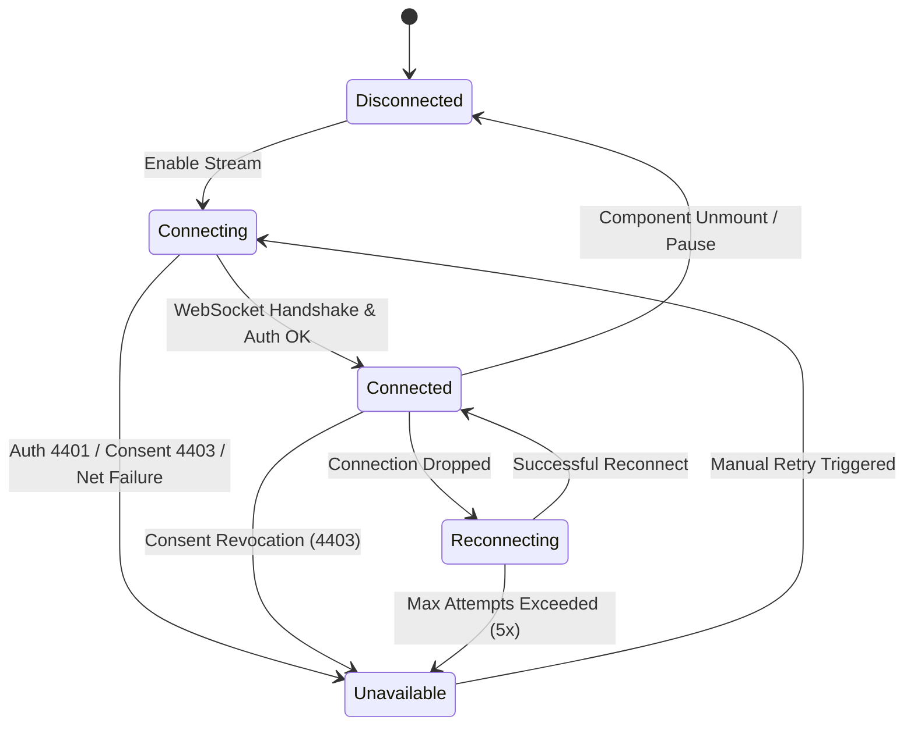

# CardioCoreEdge — Frontend–Backend Integration Status (Phase 9)

**Status:** Completed & Validated (Single-Lead Synthetic Live Monitoring)  
**Specification Version:** v1.1.0  
**Target Environment:** Local Development / Edge Integration Testing  

---

## 1. Architectural Principles & Safety Policies

In accordance with Phase 8 and Phase 9 non-negotiable project constraints:

1. **Demonstration Mode as Default**:
   - The application defaults to Demonstration Mode (`NEXT_PUBLIC_ENABLE_REAL_BACKEND=false`).
   - The established persistent demonstration banner remains visible across all views.
2. **Explicit Real-Backend Feature Flag**:
   - Live integration with the FastAPI backend requires explicit developer enablement via:
     ```env
     NEXT_PUBLIC_ENABLE_REAL_BACKEND=true
     NEXT_PUBLIC_API_URL=http://127.0.0.1:8000/api/v1
     ```
3. **Strict Data Provenance Isolation**:
   - Demonstration fixtures and server-connected data are strictly isolated.
   - Every live monitoring screen displays a persistent, non-dismissible safety badge:  
     **`SYNTHETIC TELEMETRY — NOT REAL PATIENT DATA`**
4. **No Silent Fallback**:
   - If the backend server drops or is unavailable, the interface displays an explicit error banner and transitions to an `unavailable` state.
   - It **never** silently swaps in fake simulated data to masquerade as an active server connection.
5. **No Clinical Alert Dispatch**:
   - Waveform patterns, arrhythmia indicators, and decision gating are strictly prototype simulation logic and not clinically validated. No external emergency or EMR alerts are dispatched.

---

## 2. Route Inventory & Integration Contracts

### A. Next.js Frontend Routes (`cardiocore-next/`)

| Route | Role | Auth State | Telemetry Integration |
| :--- | :--- | :--- | :--- |
| `/` | Public | None | None (Public landing page, specialists, and FAQ). |
| `/login` | Public | None | Submits credentials to `/api/v1/auth/login/*`. Sets HTTP-only `cc_session`. |
| `/patient?view=live` | Patient | Patient Session / Demo | **Phase 9 Live Waveform Monitor** (Lead-II, 250 Hz, WebSocket). |
| `/patient?view=ecg` | Patient | Patient Session / Demo | 30-Second single-lead lab review strip. |
| `/patient?view=home` | Patient | Patient Session / Demo | Personal baseline summary, 90-day beat count, care team records. |
| `/doctor` | Clinician | Clinician Session (2FA) / Demo | Doctor roster, patient detail review, consent-gated telemetry. |

---

### B. FastAPI Backend Endpoints (`backend/`)

#### 1. HTTP Endpoints
- `GET /api/v1/health`: Returns API service name (`CardioCoreEdge API`) and version (`0.1.0`).
- `POST /api/v1/auth/login/patient`: Patient authentication returning secure session cookies.
- `POST /api/v1/auth/login/doctor`: Clinician 2FA login (Argon2id + TOTP + Medical Council check).
- `POST /api/v1/auth/logout`: Revokes database session and clears cookies.
- `GET /api/v1/patients/me`: Returns authenticated patient profile.
- `GET /api/v1/doctors/roster`: Returns clinician roster with department, institution, and availability.
- `POST /api/v1/telemetry/batch`: Idempotent batch recovery upload (max 50 frames per request).
- `GET /api/v1/telemetry/chunk/{chunk_id}`: Retrieves stored chunk metadata and SQI.

#### 2. WebSocket Telemetry Streaming Endpoint
- **URL**: `ws://127.0.0.1:8000/api/v1/telemetry/ws/{session_token}`
- **Query Parameters**:
  - `device_id`: Device identifier string (e.g., `dev_synthetic_01`).
  - `mode`: Operational mode (`ingest` or `monitor`).
  - `patient_id`: Optional target patient identifier for clinician sessions.

---

## 3. WebSocket Operational Modes & Lifecycle



### A. Monitor Mode (`mode=monitor`)
- **Direction**: Server $\rightarrow$ Client.
- **Payload**: Binary 28-byte v1 header + raw `int16` ADC samples + CRC-32 checksum.
- **Sampling Frequency**: Exact 250 Hz (50 samples every 200 ms = 5 frames per second).
- **Consent Gating**: Verified on connection and polled periodically (every 1 second). If consent is revoked, stream terminates immediately with close code `4403`.
- **Client Rendering**: Rendered on a medical-standard ECG canvas grid (25 mm/s paper speed, 10 mm/mV voltage calibration).

### B. Ingest Mode (`mode=ingest`, default)
- **Direction**: Client $\rightarrow$ Server.
- **Payload**: Binary 28-byte v1 header + delta-compressed or raw payload.
- **Server Response**: Binary ACK (`0x03`) or Backpressure Warning (`0x04`) at high watermark.

---

## 4. Connection Lifecycle & Error Handling Matrix

| Connection State | UI Badge | Data Source | Behavior on Network Failure |
| :--- | :--- | :--- | :--- |
| **`disconnected`** | Slate pill ("Disconnected") | None | Idle. No WebSocket open. |
| **`connecting`** | Amber pulsing pill ("Connecting...") | None | Awaiting WebSocket handshake and auth check. |
| **`connected`** | Emerald pulsing pill ("Live Connected - 250 Hz") | Live FastAPI Binary Stream | Streaming active. Bounded ring buffer updating. |
| **`reconnecting`** | Amber pill ("Reconnecting - Backoff Active") | Frozen previous strip | Bounded exponential backoff ($1\text{s} \times 2^{\text{attempt}} \pm 20\%$ jitter). |
| **`unavailable`** | Rose pill ("Server Unavailable") | None (Flatline) | **Explicit error banner displayed.** No silent mock fallback. Retry button provided. |

### Error Codes
- **`4401`**: Authentication failure (invalid or expired session token). Client stops reconnecting and prompts for login.
- **`4403`**: Authorization failure or consent revoked. Client halts stream immediately.
- **`4429`**: Concurrency limit exceeded (max 2 active streams per patient).
- **`5000`**: Storage or database persistence failure.

---

## 5. Client-Side Bounded Buffering & Memory Protection

To ensure the web application never experiences memory growth or browser tab crashes during extended live monitoring:

1. **Fixed Ring Buffer Capacity**:
   - Maximum capacity is hard-bounded to **1,250 samples** (exactly 5.0 seconds at 250 Hz).
   - Older samples are trimmed using array slicing (`next.slice(-bufferCapacity)`).
   - Memory allocation remains flat at $< 50\text{ KiB}$ for waveform data regardless of session duration.
2. **Resource Cleanup on Route Change**:
   - `useTelemetryStream` registers an unmount cleanup effect:
     - Closes the active WebSocket connection.
     - Cancels all pending reconnection timers (`clearTimeout`).
     - Cancels stale data interval timers (`clearInterval`).
     - Cancels active `requestAnimationFrame` render loops.
3. **Reduced Motion Adaptation**:
   - Automatically detects `prefers-reduced-motion: reduce`.
   - Pauses high-frequency canvas sweep animations, providing accessible manual Play/Pause/Reset controls.

---

## 6. Phase 10 Hardened Security Boundaries & Recovery Contracts

1. **Mid-Stream Session Invalidation**:
   - WebSockets validate authentication not only during the initial handshake, but periodically (every 5 frames / 1.0 second).
   - If a session is invalidated (due to patient logout, idle timeout, or administrative revocation), active WebSockets receive an error frame and close immediately with code `4401`.
2. **Cross-Patient Stream Isolation**:
   - Patients are strictly prohibited from accessing or streaming telemetry belonging to other patient identifiers (`/ws/{token}?patient_id={other_patient}`).
   - Any mismatched patient query parameter requested by a non-doctor role is terminated immediately with code `4403`.
3. **HTTP Batch Upload Recovery Idempotency**:
   - The recovery endpoint `POST /api/v1/telemetry/batch` enforces strict idempotency.
   - Retrying identical batches yields `processedChunks = 0` and `duplicateChunks = N` without duplicate row insertion.
   - Conflicting frames (matching timestamps with mismatched checksums) are safely rejected (`conflictChunks = N`).
   - Batch size is bounded to `MAX_BATCH_FRAMES = 50`. Requests exceeding this limit return `400 Bad Request`.
   - Clinician batch recovery is gated on active ECG consent grants; revoked consent returns `403 Forbidden`.
