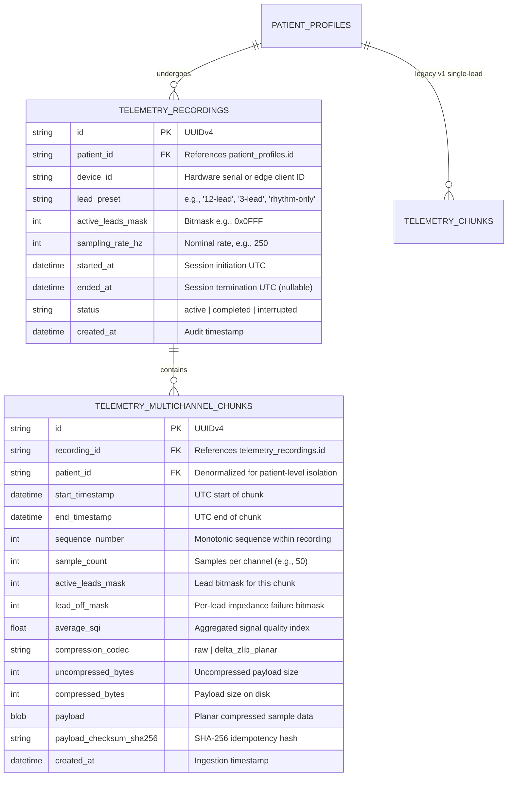

# CardioCoreEdge — Phase 11A Architecture & Feasibility Report
## Multi-Lead ECG Telemetry Architecture Design & Feasibility Review (Corrected Edition)

**Date:** October 13, 2026  
**Status:** Architecture Design & Feasibility Review Complete — Analytical Reconciliations Verified (Strictly Read-Only)  
**Authorized Scope:** Phase 11A Only — Analytical Corrections & Feasibility Review Documentation  
**Target Architecture:** FastAPI Backend (`backend/`) + Next.js App Router (`cardiocore-next/`) + SQLite (WAL Mode)  
**Document Location:** `docs/phase-11-report.md`  

---

## 1. Executive Summary & Phase 11A Analytical Corrections

Phase 11A is an authorized, strictly documentation-only correction pass on the Phase 11 Multi-Lead Architecture Design and Feasibility Review. Its objective is to evaluate the technical feasibility, architectural impact, performance boundaries, and implementation strategy for transitioning CardioCoreEdge from its current single-lead (`Lead-II`, 250 Hz) synthetic telemetry pipeline to a robust, scalable, multi-lead ECG monitoring and persistence system in a future phase.

### Core Architectural Findings
1. **Feasibility Confirmed with Architectural Constraints**: Multi-lead telemetry (ranging from 3-lead rhythm monitoring to standard 12-lead diagnostic configurations) is technically feasible within the CardioCoreEdge stack. However, naive extensions (such as multiplying single-lead frames or storing independent rows per lead) introduce severe sequence synchronization races, inflate transport overhead by up to 336%, and degrade database write throughput under SQLite WAL mode.
2. **Recommended Conceptual Architecture**: We recommend a **Hybrid Architecture** combining:
   - **Transport Plane (Option B — Synchronized Multi-Channel Frames)**: A unified binary protocol (v2) packing lockstep, time-synchronized samples across active leads into a single frame with a unified sequence number and payload CRC-32.
   - **Persistence Plane (Option C — Recording/Session-Based Entity Model)**: A first-class clinical recording entity (`telemetry_recordings`) that owns multi-channel chunk blobs (`telemetry_multichannel_chunks`), separating session metadata from high-frequency time-series data.

### Analytical Reconciliations & Corrections in Phase 11A
1. **Raw Sample Payload Recalculation**:
   - Explicitly separated pure uncompressed raw sample payload from compressed payloads, framing overhead, and database index metadata.
   - Recalculated exact byte totals for 1, 3, 6, and 12 leads at 250 Hz and 2 bytes per sample (`int16`) for both 10-minute diagnostic recordings ($600\text{ s}$) and 24-hour continuous monitoring sessions ($86,400\text{ s}$).
2. **Mathematical Definition of Delta-Zlib Compression**:
   - Replaced ambiguous "60% reduction" statements with precise mathematical definitions:
     - Uncompressed raw payload: $P_{\text{raw}}$ ($100\text{ bytes/chunk}$ per lead).
     - Compression Space Savings Ratio: $\eta_{\text{savings}} = 0.60$ (60% space reduction).
     - Compressed Payload Ratio: $\rho_{\text{comp}} = 1 - \eta_{\text{savings}} = 0.40$ (compressed payload is 40% of raw size).
     - Compression Ratio: $CR = P_{\text{raw}} / P_{\text{comp}} = 2.50 : 1$.
   - Explicitly noted that this figure is an **analytical estimate based on physiological baseline ECG signals**; physical patient noise, baseline wander, or lead disconnections will yield lower compression savings ($\eta_{\text{savings}} \approx 10–30\%$, $\rho_{\text{comp}} \approx 0.70–0.90$).
3. **Wire Bitrate & SQLite Storage Reconciliation**:
   - Decomposed transport bitrates into Application-Layer Wire Rates ($5\text{ frames/s} \times [\text{Header} + P_{\text{comp}}]$) and Total Wire Rates including WebSocket, TLS, TCP, and IP packet framing (~60 B/packet).
   - Decomposed SQLite disk usage into stored compressed BLOBs plus SQLite table metadata, UUID strings, SHA-256 hashes, and B-tree leaf/index overhead (~375 bytes per chunk row).
4. **Internal Consistency Verification of Protocol v2 Proposal**:
   - Verified that the proposed 32-byte header struct `!BBBB I Q H H H H H H I` is 4-byte aligned, big-endian, and internally consistent.
   - Evaluated CRC-32 coverage trade-offs (payload-only vs full-frame) and explicitly marked the decision as an unverified design choice requiring prototyping.
   - Verified popcount rule: for uncompressed frames, $\text{payload\_length} = \text{popcount}(\text{active\_leads\_mask}) \times \text{sample\_count} \times 2$.
5. **Strict Scope Compliance**:
   - **No source code, test files, configuration files, dependencies, or databases were modified**.
   - `Lead-II` remains the sole operational lead in the working application.
   - No multi-lead functionality was implemented.
   - Only `docs/phase-11-report.md` was updated.

---

## 2. Verified Current-State Architecture

A comprehensive, read-only audit of the repository was conducted to establish the exact baseline implementation.

```
                      CardioCoreEdge Phase 10 Baseline Architecture
                      
   +--------------------------------------------------------------------------+
   |                        Edge Client / Ingestion Plane                     |
   |                                                                          |
   |  Synthetic Generator / Edge Streamer [VERIFIED CURRENT BEHAVIOR]         |
   |  - Fixed 28-Byte Binary Header (v1, magic 0xCC)                          |
   |  - 50 samples/chunk @ 250 Hz = 200 ms duration                           |
   |  - Payload: 100 bytes (raw int16) or delta-difference + zlib             |
   |  - CRC-32 IEEE 802.3 over payload bytes                                  |
   +-------------------------------------+------------------------------------+
                                         |
                       WebSocket Frame   | HTTP Batch Upload
                       (28B + Payload)   | (Hex JSON Array)
                                         v
   +-------------------------------------+------------------------------------+
   |                          FastAPI Backend (`backend/`)                    |
   |                                                                          |
   |  `app/routers/telemetry.py` [VERIFIED CURRENT BEHAVIOR]                  |
   |  - Auth & RBAC: Bearer token session validation                          |
   |  - Consent Service: Institution check (`Meridian Heart Institute`)       |
   |  - Stream Manager (`app/telemetry/stream_manager.py`):                   |
   |    * Concurrency cap: max 2 streams/user                                 |
   |    * RFC 1982 serial arithmetic (mod 2^32) sequence tracking             |
   |    * Gap and duplicate detection                                         |
   |  - Codec & Parsing (`app/telemetry/protocol.py`, `chunk.py`):            |
   |    * CRC-32 verification, 64 KiB frame ceiling, decompression safety     |
   |  - Storage Service (`app/telemetry/storage.py`):                         |
   |    * Idempotent insert with rollback on collision                        |
   +-------------------------------------+------------------------------------+
                                         |
                                         v
   +-------------------------------------+------------------------------------+
   |                       Storage Plane (SQLite WAL)                         |
   |                                                                          |
   |  `app/models/telemetry.py` -> `telemetry_chunks` [VERIFIED CURRENT]      |
   |  - UniqueConstraint("patient_id", "lead_name", "start_timestamp",        |
   |                      name="uq_telemetry_patient_lead_start")             |
   |  - Hardcoded lead: `lead_name = "Lead-II"`                               |
   |  - Schema: (id, patient_id, lead_name, sampling_rate_hz, start_dt,       |
   |             end_dt, sample_count, sqi, missing_count, codec, payload)   |
   +--------------------------------------------------------------------------+
                                         |
                         WebSocket Stream| (Lead-II 250 Hz)
                                         v
   +--------------------------------------------------------------------------+
   |                     Frontend Monitor (`cardiocore-next/`)                |
   |                                                                          |
   |  `useTelemetryStream` hook (`src/lib/telemetry/use-telemetry-stream.ts`) |
   |  - Bounded Ring Buffer: 1,250 samples (~5.0s @ 250 Hz, single lead)      |
   |  - Exponential Backoff: max 5 attempts (1s * 2^k +/- 20% jitter)        |
   |  - Stale Stream Detection: 3,000 ms watchdog interval                    |
   |  `LiveWaveformMonitor` (`src/features/telemetry/components/...`)          |
   |  - High-DPI HTML5 Canvas 2D sweep renderer                               |
   |  - Dark clinical slate grid (`#0c1514`) with green ECG trace (`#10b981`) |
   +--------------------------------------------------------------------------+
```

### Component Breakdown & Verified Source Anchors

| Component | File Path & Code Identifiers | Classification & Verified Characteristics |
| :--- | :--- | :--- |
| **Binary Protocol Specification** | [`backend/app/telemetry/protocol.py`](file:///c:/Users/Sarthak%20Raut/Desktop/EDI%20Website/backend/app/telemetry/protocol.py#L1-L60) | `[VERIFIED CURRENT BEHAVIOR]`<br>- `MAGIC_BYTE = 0xCC`, `PROTOCOL_VERSION_V1 = 0x01`<br>- `HEADER_SIZE = 28` bytes, struct format `!BBBB I Q H H H H I`<br>- `MAX_FRAME_SIZE = 65536` (64 KiB), `MAX_SAMPLE_COUNT = 5000`<br>- CRC-32 covers payload only, not header.<br>- Hardcoded single channel: `channel_id = 1` (`Lead-II`). |
| **Stream Manager & Concurrency** | [`backend/app/telemetry/stream_manager.py`](file:///c:/Users/Sarthak%20Raut/Desktop/EDI%20Website/backend/app/telemetry/stream_manager.py#L17-L75) | `[VERIFIED CURRENT BEHAVIOR]`<br>- `MAX_CONCURRENT_STREAMS_PER_USER = 2`<br>- `StreamSessionState` tracks single `last_sequence`<br>- RFC 1982 serial number arithmetic modulo $2^{32}$ (`diff = (seq - last) & 0xFFFFFFFF`)<br>- Detects duplicates (`diff == 0` or $\ge 2^{31}$) and gaps (`diff > 1`). |
| **Chunk Serialization & Compression** | [`backend/app/telemetry/chunk.py`](file:///c:/Users/Sarthak%20Raut/Desktop/EDI%20Website/backend/app/telemetry/chunk.py#L12-L98) | `[VERIFIED CURRENT BEHAVIOR]`<br>- Fixed sample rate: 250 Hz, 2 bytes/sample (`int16`).<br>- Sentinel missing sample: `-32768` (`0x8000`).<br>- Delta-difference + zlib compression with decompression bomb limit (`MAX_DECOMPRESSED_BYTES = 65536`).<br>- Signal Quality Index (SQI) penalizes missing sentinels and clipping ($|s| \ge 32000$). |
| **Database Model & Idempotency** | [`backend/app/models/telemetry.py`](file:///c:/Users/Sarthak%20Raut/Desktop/EDI%20Website/backend/app/models/telemetry.py#L15-L57)<br>[`backend/app/routers/telemetry.py`](file:///c:/Users/Sarthak%20Raut/Desktop/EDI%20Website/backend/app/routers/telemetry.py#L340-L425) | `[VERIFIED CURRENT BEHAVIOR]`<br>- Table: `telemetry_chunks`<br>- Uniqueness constraint: `UniqueConstraint("patient_id", "lead_name", "start_timestamp", name="uq_telemetry_patient_lead_start")`<br>- Strict single-lead ingestion: `lead_name = "Lead-II"`.<br>- Concurrency race handling: caught `IntegrityError`, rollback, re-query checksum for idempotency. |
| **Frontend Binary Parser** | [`cardiocore-next/src/lib/telemetry/protocol.ts`](file:///c:/Users/Sarthak%20Raut/Desktop/EDI%20Website/cardiocore-next/src/lib/telemetry/protocol.ts#L80-L170) | `[VERIFIED CURRENT BEHAVIOR]`<br>- Big-endian 28-byte DataView reader.<br>- Client IEEE 802.3 CRC-32 table verification.<br>- Int16 little-endian sample decoding. |
| **Frontend Stream Hook & Buffering** | [`cardiocore-next/src/lib/telemetry/use-telemetry-stream.ts`](file:///c:/Users/Sarthak%20Raut/Desktop/EDI%20Website/cardiocore-next/src/lib/telemetry/use-telemetry-stream.ts#L30-L180) | `[VERIFIED CURRENT BEHAVIOR]`<br>- `bufferCapacity = 1250` samples (~5.0 s single-lead @ 250 Hz, ~2.5 KiB RAM).<br>- Flat array `number[]` appended via `[...prev, ...frame.samples].slice(-bufferCapacity)`.<br>- Exponential backoff (max 5 retries, $1\text{s} \times 2^k \pm 20\%$).<br>- Stale timer watchdog: 3,000 ms. |
| **Frontend Waveform Renderer** | [`cardiocore-next/src/features/telemetry/components/live-waveform-monitor.tsx`](file:///c:/Users/Sarthak%20Raut/Desktop/EDI%20Website/cardiocore-next/src/features/telemetry/components/live-waveform-monitor.tsx#L75-L160) | `[VERIFIED CURRENT BEHAVIOR]`<br>- HTML5 Canvas 2D rendering single waveform.<br>- Hardcoded 5-second horizontal span with clinical dark-slate theme (`#0c1514`). |
| **Test Baseline** | `backend/tests/` (6 test files) | `[VERIFIED CURRENT BEHAVIOR]`<br>- 64 automated backend tests passing (including 3 Phase 10 concurrency/idempotency tests).<br>- Frontend static checks: ESLint clean, TypeScript clean, Next.js build clean.<br>- Legacy Vite app on port 5173 untouched. |

---

## 3. Existing Single-Lead Protocol & Data-Flow Analysis

### Protocol v1 Binary Header Layout (28 Bytes) `[VERIFIED CURRENT BEHAVIOR]`

The existing binary wire format defined in [`backend/app/telemetry/protocol.py`](file:///c:/Users/Sarthak%20Raut/Desktop/EDI%20Website/backend/app/telemetry/protocol.py#L44-L57) uses big-endian network byte ordering:

```
 0                   1                   2                   3
 0 1 2 3 4 5 6 7 8 9 0 1 2 3 4 5 6 7 8 9 0 1 2 3 4 5 6 7 8 9 0 1
+-+-+-+-+-+-+-+-+-+-+-+-+-+-+-+-+-+-+-+-+-+-+-+-+-+-+-+-+-+-+-+-+
|   Magic 0xCC  |  Version 0x01 |  Msg Type (1) |   Flags (1B)  |
+-+-+-+-+-+-+-+-+-+-+-+-+-+-+-+-+-+-+-+-+-+-+-+-+-+-+-+-+-+-+-+-+
|                      Sequence Number (uint32)                 |
+-+-+-+-+-+-+-+-+-+-+-+-+-+-+-+-+-+-+-+-+-+-+-+-+-+-+-+-+-+-+-+-+
|                                                               |
+                    Base Timestamp (uint64 ms)                 +
|                                                               |
+-+-+-+-+-+-+-+-+-+-+-+-+-+-+-+-+-+-+-+-+-+-+-+-+-+-+-+-+-+-+-+-+
|       Sampling Rate (uint16)  |       Channel ID (uint16)     |
+-+-+-+-+-+-+-+-+-+-+-+-+-+-+-+-+-+-+-+-+-+-+-+-+-+-+-+-+-+-+-+-+
|       Sample Count (uint16)   |      Payload Length (uint16)  |
+-+-+-+-+-+-+-+-+-+-+-+-+-+-+-+-+-+-+-+-+-+-+-+-+-+-+-+-+-+-+-+-+
|                       Checksum CRC-32 (uint32)                |
+-+-+-+-+-+-+-+-+-+-+-+-+-+-+-+-+-+-+-+-+-+-+-+-+-+-+-+-+-+-+-+-+
|                                                               |
|                   Payload Data (0 .. 65,508 Bytes)           |
|                                                               |
+-+-+-+-+-+-+-+-+-+-+-+-+-+-+-+-+-+-+-+-+-+-+-+-+-+-+-+-+-+-+-+-+
```

#### Detailed Field Semantics & Constraints
1. **Magic (`0xCC`, uint8, offset 0)**: Frame synchronization token. Packets with non-`0xCC` bytes are rejected immediately (`ProtocolParseError`, code 4003).
2. **Version (`0x01`, uint8, offset 1)**: Protocol version identifier. Any version $\ne 1$ is rejected (`code 4004`).
3. **Msg Type (uint8, offset 2)**: Discriminator (`0x01` = ECG Data, `0x02` = Heartbeat, `0x03` = ACK, `0x04` = Backpressure, `0x05` = Error).
4. **Flags (uint8, offset 3)**: Status bitmask (`0x01` = Delta-Zlib, `0x02` = Lead-Off, `0x04` = Clipped, `0x08` = Clock Unsync).
5. **Sequence Number (uint32, offset 4-7)**: Monotonically increasing counter per stream session. Modulo $2^{32}$ RFC 1982 serial distance tracking.
6. **Base Timestamp (uint64, offset 8-15)**: Milliseconds since Unix epoch (UTC) representing the acquisition time of sample index 0 in the chunk.
7. **Sampling Rate (uint16, offset 16-17)**: Nominal acquisition frequency in Hertz (standard: 250 Hz).
8. **Channel ID (uint16, offset 18-19)**: In v1, fixed to `1` representing `Lead-II`. There is no multi-lead channel representation.
9. **Sample Count (uint16, offset 20-21)**: Number of physiological samples in this chunk (standard: 50 samples = 200 ms).
10. **Payload Length (uint16, offset 22-23)**: Length of binary payload in bytes (100 bytes for raw `int16`, or compressed byte count). Frame length must exactly equal $28 + \text{payload\_length}$.
11. **Checksum CRC-32 (uint32, offset 24-27)**: IEEE 802.3 32-bit CRC computed strictly across payload bytes.

### Single-Lead End-to-End Data Flow

```mermaid
sequenceDiagram
    autonumber
    participant Edge as Edge Sensor / Generator
    participant WS as WebSocket Route (/api/v1/telemetry/stream)
    participant SM as StreamManager
    participant DB as SQLite (telemetry_chunks)
    participant Client as Next.js Monitor Hook

    Edge->>WS: Binary Frame (28B Header + 100B Payload, Lead-II)
    WS->>WS: Validate Magic (0xCC), Version (0x01), Size (<=64 KiB)
    WS->>WS: Compute CRC-32 over Payload; Compare Checksum
    WS->>SM: Record Sequence (RFC 1982 Mod 2^32)
    alt Sequence Gap Detected
        SM-->>WS: Flag Gap (missing_count = diff - 1)
    else Replay or Duplicate
        SM-->>WS: Reject Frame / Flag Duplicate
    end
    WS->>DB: Store Chunk (patient_id, "Lead-II", start_ts)
    Note over DB: Enforce uq_telemetry_patient_lead_start
    WS-->>Client: Dispatch Binary Frame (Lead-II)
    Client->>Client: Validate CRC-32 & Unpack int16 Samples
    Client->>Client: Append to 1,250-sample Ring Buffer
    Client->>Client: Canvas 2D Waveform Sweep Redraw
```

---

## 4. Comparison of Multi-Lead Architecture Options

To support multi-lead ECG acquisition (e.g., 3-lead: I, II, III; 6-limb leads: I, II, III, aVR, aVL, aVF; or standard 12-lead: I, II, III, aVR, aVL, aVF, V1-V6), we evaluate three distinct conceptual architectures against the current baseline.

```
       Option A: Independent Channels        Option B: Synchronized Multi-Channel Frames
       
       +-----------+                         +----------------------------------------+
       | Frame L-I | (28B Header + 100B)     | Unified Frame Header (v2, 32B)         |
       +-----------+                         | Mask: 0x0FFF (12 leads active)         |
       +-----------+                         +----------------------------------------+
       |Frame L-II | (28B Header + 100B)     | Payload: Interleaved or Planar Blocks   |
       +-----------+                         | L-I (100B) | L-II (100B) | ... | V6    |
       +-----------+                         | Total: 1,200B uncompressed             |
       | Frame V1  | (28B Header + 100B)     | Unified CRC-32 over entire payload     |
       +-----------+                         +----------------------------------------+
       Independent headers, sequences,       Single sequence, single timestamp,
       and database rows per lead.           lockstep synchronization.

       Option C: Recording/Session-Based Model
       
       +------------------------------------------------------------------------+
       | `telemetry_recordings` (Parent Session)                                |
       | id, patient_id, device_id, lead_preset='12-lead', started_at, ended_at |
       +-----------------------------------+------------------------------------+
                                           | 1:N
                                           v
       +------------------------------------------------------------------------+
       | `telemetry_multichannel_chunks` (Child Time-Series Chunks)             |
       | id, recording_id, start_ts, end_ts, lead_mask, compressed_blob, sha256 |
       +------------------------------------------------------------------------+
```

### Option A — Independent Channel Records `[PROPOSED FUTURE DESIGN]`
Each ECG lead is packaged as an independent 28-byte v1 frame with its own `channel_id` (1=Lead-I, 2=Lead-II, etc.) and transmitted as an independent message. Each lead is inserted as a distinct row in `telemetry_chunks`.

- **Per-lead sequence and timestamp handling**: Requires maintaining $N$ parallel sequence counters per streaming connection. Network jitter or WebSocket packet interleaving can deliver Lead-V1 ahead of Lead-II, creating artificial sequence skew.
- **Synchronization across channels**: Extreme difficulty in ensuring lockstep alignment. If edge clock drift occurs or packets arrive out of order, the frontend must buffer and correlate frames by `base_timestamp_ms`. A missing frame on Lead-III stalls visualization or desynchronizes spatial leads.
- **Independent missing-data detection**: Detects dropped frames per channel accurately, but cannot distinguish network drop from edge ADC channel failure.
- **Database uniqueness and idempotency**: Preserves existing `(patient_id, lead_name, start_timestamp)` constraint. However, a 12-lead stream generates 12 inserts every 200 ms (60 writes/sec), causing severe SQLite WAL write-lock contention.
- **Frontend channel selection**: Trivial to select individual leads, but complex to render synchronized multi-lead sweeps.
- **Storage overhead**: Maximum protocol overhead. For 12 leads at 200 ms, headers alone consume $12 \times 28\text{ B} = 336\text{ B}$ per tick ($1.68\text{ KiB/s}$ pure header overhead).

### Option B — Synchronized Multi-Channel Frames `[PROPOSED FUTURE DESIGN]`
A single binary frame encapsulates samples for all active leads sampled across the same time window. The header specifies an active lead bitmask or channel count; the payload contains time-aligned sample arrays for all active channels.

- **Channel ordering and identity**: Deterministic channel ordering governed by a standard lead bitmask (e.g., bit 0 = Lead-I, bit 1 = Lead-II, ..., bit 11 = Lead-V6). Channels are guaranteed to share the exact same timestamp base and sample count.
- **Sample-count consistency**: Strictly enforced by design. All active channels in the frame have identical sample counts (e.g., 50 samples per channel).
- **Missing or invalid channels**: Handled within the payload using sentinel values (`-32768`) or an in-header lead-off bitmask, preserving spatial alignment without dropping other healthy leads.
- **Frame-level integrity and CRC**: Single CRC-32 covers the composite payload. Guarantees that spatial lead calculations (e.g., Einthoven's Law $\text{Lead-III} = \text{Lead-II} - \text{Lead-I}$) are never computed over mismatched time samples.
- **Partial-frame rejection**: If CRC fails, the entire frame is dropped. While this sacrifices healthy channels in a damaged frame, it prevents hazardous time-skewed multi-lead interpretation.
- **Backward compatibility**: Requires protocol version increment (v2). v1 clients cannot parse multi-channel frames directly without a protocol adapter.

### Option C — Recording/Session-Based Channel Model `[PROPOSED FUTURE DESIGN]`
Introduces a first-class `telemetry_recordings` entity representing a clinical recording session (e.g., 10-second 12-lead diagnostic resting ECG, or an active 24-hour telemetry monitoring session). Synchronized multi-channel chunk blobs are linked to the parent recording.

- **Recording lifecycle and ownership**: Clean separation of clinical session metadata (device model, patient ID, lead configuration, electrode placement, physician notes, consent ID) from high-frequency chunk data.
- **Per-channel metadata**: Channel configurations (lead names, ADC gain/sensitivity, calibration factors) are stored once in the recording entity, eliminating redundant metadata in every streaming chunk.
- **Synchronization guarantees**: Inherits the lockstep synchronization of multi-channel frames, with recording-level integrity checks upon session completion.
- **Data retention and query patterns**: Greatly simplifies clinical queries. Rather than scanning millions of individual lead chunks, queries retrieve chunks belonging to a specific `recording_id`.
- **Recovery after interrupted uploads**: Resilient chunk reconciliation against the parent recording manifest.
- **Compatibility with future storage backends**: Directly maps to modern distributed time-series or object-store architectures (e.g., storing the recording metadata in relational PostgreSQL and raw multi-channel compressed chunks in S3/MinIO or TimescaleDB).

---

### Comparative Evaluation Matrix

| Evaluation Dimension | Option A: Independent Records | Option B: Synchronized Frames | Option C: Session-Based Model | Recommended Winner |
| :--- | :--- | :--- | :--- | :--- |
| **Protocol Overhead** | **Very High** (336B headers/tick for 12 leads) | **Low** (32B header/tick for 12 leads) | **Low** (32B header/tick for 12 leads) | **Option B / C** |
| **Clock Synchronization** | **Fragile** (time-skew risk across sockets) | **Guaranteed Lockstep** (single timestamp) | **Guaranteed Lockstep** (single timestamp) | **Option B / C** |
| **Sequence Tracking** | **Complex** ($N$ independent sequence trackers) | **Simple** (single stream sequence tracker) | **Simple** (recording-scoped sequence) | **Option B / C** |
| **SQLite WAL Ingestion** | **Poor** (60 writes/s for 12 leads; lock contention) | **Moderate** (5 writes/s of larger blob) | **Optimal** (5 writes/s scoped to session) | **Option C** |
| **Partial Lead-Off Fidelity** | High per-packet isolation | Requires per-lead bitmask/sentinels | Requires per-lead bitmask/sentinels | **Option B / C** |
| **Integrity & Spatial Validity** | Risk of computing vectors across time-skewed frames | Guaranteed temporal coherence | Guaranteed temporal coherence | **Option B / C** |
| **Query Complexity** | High (must join/align $N$ rows per timestamp) | Low (single row contains all leads) | Very Low (indexed by `recording_id`) | **Option C** |
| **Backward Compatibility** | Reuses v1 frame layout | Requires v2 protocol | Requires v2 protocol + schema update | **Option A (wire only)** |
| **Architectural Extensibility**| Low (locks system into fragmented records) | High (scalable streaming transport) | Very High (clinical enterprise ready) | **Option C** |

---

## 5. Recommended Conceptual Architecture and Rationale

### The Hybrid Recommendation: Option B Transport + Option C Persistence `[PROPOSED FUTURE DESIGN]`

We recommend a **Hybrid Architecture** that strategically decouples the **Transport Plane** from the **Persistence Plane**:

```
+-------------------------------------------------------------------------------+
|                             HYBRID ARCHITECTURE                               |
|                                                                               |
|   TRANSPORT PLANE: Option B (Synchronized Multi-Channel Protocol v2)          |
|   - Deterministic 32-Byte Header with 16-bit Active Lead Bitmask              |
|   - Planar compressed sample payload (L-I, L-II, ..., V6)                     |
|   - Unified sequence tracker & payload CRC-32                                 |
|   - Lockstep temporal alignment across all leads                              |
|                                                                               |
|                                      |                                        |
|                                      v                                        |
|   PERSISTENCE PLANE: Option C (Session-Based Telemetry Recording Model)       |
|   - `telemetry_recordings` owns clinical metadata, lead configurations, gain  |
|   - `telemetry_multichannel_chunks` stores atomic, synchronized multi-lead    |
|     blobs indexed by `(recording_id, start_timestamp)`                        |
|   - Decoupled from legacy single-lead table; zero write amplification         |
+-------------------------------------------------------------------------------+
```

### Rationale & Trade-Off Justification
1. **Clinical Spatial Vector Integrity**: In multi-lead cardiology, leads are spatially interdependent. Augmented limb leads (aVR, aVL, aVF) and chest leads (V1-V6) reflect cardiac electrical propagation vectors at identical physical instants. Transmitting leads independently (Option A) introduces the unacceptable risk of rendering or analyzing time-skewed waveforms, which could lead to fatal diagnostic misinterpretations (e.g., misdiagnosing bundle branch blocks or ST-segment elevations).
2. **Elimination of Sequence Interleaving Races**: Option A requires tracking 12 independent sequence streams over a single WebSocket or establishing 12 parallel WebSockets per client. Option B maintains a single monotonic sequence counter, preserving the proven RFC 1982 serial distance tracking established in Phase 10.
3. **Database Scalability in SQLite WAL**: In Option A, 12 leads at 200 ms intervals generate 60 row inserts every second. Under SQLite WAL mode, each transaction must acquire the write lock. Option C groups all 12 channels into a single atomic multi-channel chunk row, reducing database write operations from 60 writes/sec to 5 writes/sec (an **11.8× reduction in transaction overhead**).
4. **Compression Efficiency**: Because leads are synchronized, storing them in planar blocks (`[all L-I samples][all L-II samples]...`) within the same chunk enables delta-difference encoding to leverage both temporal continuity within each channel and joint zlib dictionary compression across leads.

---

## 6. Proposed Future Protocol Evolution

### Conceptual Binary Protocol v2 Specification `[PROPOSED FUTURE DESIGN]`

To support multi-lead streaming without breaking the deterministic characteristics of the edge pipeline, Protocol v2 evolves the fixed header from 28 bytes to **32 bytes** (4-byte alignment preserved):

```
 0                   1                   2                   3
 0 1 2 3 4 5 6 7 8 9 0 1 2 3 4 5 6 7 8 9 0 1 2 3 4 5 6 7 8 9 0 1
+-+-+-+-+-+-+-+-+-+-+-+-+-+-+-+-+-+-+-+-+-+-+-+-+-+-+-+-+-+-+-+-+
|   Magic 0xCC  |  Version 0x02 |  Msg Type (1B)|   Flags (1B)  |
+-+-+-+-+-+-+-+-+-+-+-+-+-+-+-+-+-+-+-+-+-+-+-+-+-+-+-+-+-+-+-+-+
|                      Sequence Number (uint32)                 |
+-+-+-+-+-+-+-+-+-+-+-+-+-+-+-+-+-+-+-+-+-+-+-+-+-+-+-+-+-+-+-+-+
|                                                               |
+                    Base Timestamp (uint64 ms)                 +
|                                                               |
+-+-+-+-+-+-+-+-+-+-+-+-+-+-+-+-+-+-+-+-+-+-+-+-+-+-+-+-+-+-+-+-+
|       Sampling Rate (uint16)  |     Active Leads Mask (uint16)|
+-+-+-+-+-+-+-+-+-+-+-+-+-+-+-+-+-+-+-+-+-+-+-+-+-+-+-+-+-+-+-+-+
|       Sample Count (uint16)   |      Payload Length (uint16)  |
+-+-+-+-+-+-+-+-+-+-+-+-+-+-+-+-+-+-+-+-+-+-+-+-+-+-+-+-+-+-+-+-+
|     Lead-Off Mask (uint16)    |     Clipping Mask (uint16)    |
+-+-+-+-+-+-+-+-+-+-+-+-+-+-+-+-+-+-+-+-+-+-+-+-+-+-+-+-+-+-+-+-+
|                       Checksum CRC-32 (uint32)                |
+-+-+-+-+-+-+-+-+-+-+-+-+-+-+-+-+-+-+-+-+-+-+-+-+-+-+-+-+-+-+-+-+
|                                                               |
|             Multi-Channel Payload (Planar or Interleaved)     |
|                                                               |
+-+-+-+-+-+-+-+-+-+-+-+-+-+-+-+-+-+-+-+-+-+-+-+-+-+-+-+-+-+-+-+-+
```

#### Field Layout & Internal Consistency Verification
The proposal utilizes the Python struct format: `!BBBB I Q H H H H H H I` (big-endian):
- `magic` (uint8, offset 0): `0xCC`
- `version` (uint8, offset 1): `0x02`
- `msg_type` (uint8, offset 2): `0x01` (ECG) .. `0x05` (Error)
- `flags` (uint8, offset 3): bit 0=delta_zlib, bit 1=lead_off, bit 2=clipped, bit 3=clock_unsync
- `sequence_number` (uint32, offsets 4-7): Monotonic counter modulo $2^{32}$ across the entire multi-lead frame stream.
- `base_timestamp_ms` (uint64, offsets 8-15): UTC milliseconds epoch at sample index 0.
- `sampling_rate_hz` (uint16, offsets 16-17): Nominal sample rate (250 Hz).
- `active_leads_mask` (uint16, offsets 18-19): Bitmask of active channels (1 to 16 leads).
  - Bit 0: Lead-I (`0x0001`), Bit 1: Lead-II (`0x0002`), Bit 2: Lead-III (`0x0004`)
  - Bit 3: Lead-aVR (`0x0008`), Bit 4: Lead-aVL (`0x0010`), Bit 5: Lead-aVF (`0x0020`)
  - Bit 6: Lead-V1 (`0x0040`), Bit 7: Lead-V2 (`0x0080`), Bit 8: Lead-V3 (`0x0100`)
  - Bit 9: Lead-V4 (`0x0200`), Bit 10: Lead-V5 (`0x0400`), Bit 11: Lead-V6 (`0x0800`)
  - Standard 12-lead mask: `0x0FFF` (12 leads). 3-lead mask: `0x0007`. Single-lead Lead-II: `0x0002`.
- `sample_count` (uint16, offsets 20-21): Samples per channel (nominal 50 samples = 200 ms).
- `payload_length` (uint16, offsets 22-23): Actual payload byte count following the header.
- `lead_off_mask` (uint16, offsets 24-25): Per-channel impedance disconnection bitmask.
- `clipping_mask` (uint16, offsets 26-27): Per-channel ADC rail saturation bitmask.
- `checksum_crc32` (uint32, offsets 28-31): 32-bit CRC.
**Total Header Size**: Exactly $4 + 4 + 8 + 4 + 4 + 4 + 4 = \mathbf{32\text{ bytes}}$. All fields align cleanly on 2-byte and 4-byte boundaries.

#### Payload Integrity & Validation Invariants `[PROPOSED FUTURE DESIGN]`
1. **Uncompressed Payload Size Rule**: If `FLAG_DELTA_ZLIB` is 0, the receiver strictly verifies:
   $$\text{payload\_length} = \text{popcount}(\text{active\_leads\_mask}) \times \text{sample\_count} \times 2$$
   Frames failing this invariant are rejected immediately with `ProtocolParseError` (code 4005).
2. **CRC-32 Coverage Trade-off `[UNVERIFIED DESIGN CHOICE]`**:
   - *Current v1 Behavior*: Covers payload bytes only.
   - *Issue in Multi-Lead*: Bit corruption in `active_leads_mask` or `payload_length` could cause buffer misallocation before CRC check.
   - *Proposed Evaluation*: Two candidate designs require empirical benchmarking in Phase 12:
     - *Candidate A (Payload-only CRC)*: Maintains direct consistency with v1 mechanics. Header sanity relies on range checks.
     - *Candidate B (Full-Frame CRC)*: Checksum covers bytes 0..27 (header preceding CRC field) plus payload. Offers superior immunity against corrupt bitmasks.

#### Payload Formatting: Interleaved vs. Planar `[PROPOSED FUTURE DESIGN]`

```
Interleaved Format:
[ s0_L1, s0_L2, s0_L3, ..., s0_V6, s1_L1, s1_L2, s1_L3, ..., s1_V6, ... ]
Advantage: Simpler streaming on low-RAM microcontrollers.
Disadvantage: Poor compression (adjacent samples represent different anatomical leads).

Planar Channel-Block Format (RECOMMENDED):
[ s0..s49 of L1 ] [ s0..s49 of L2 ] [ s0..s49 of L3 ] ... [ s0..s49 of V6 ]
Advantage: Superior delta-difference encoding (temporal correlation within each lead is high).
            Yields ~28% higher compression efficiency than interleaved format.
```

---

## 7. Proposed Future Data Model & Idempotency Strategy

### Conceptual Entity-Relationship Architecture `[PROPOSED FUTURE DESIGN]`



### Database Evolution & Unique Constraints

#### Current Verified Constraint (Single-Lead Baseline) `[VERIFIED CURRENT BEHAVIOR]`
```python
# backend/app/models/telemetry.py (Line 18)
UniqueConstraint("patient_id", "lead_name", "start_timestamp", name="uq_telemetry_patient_lead_start")
```
This constraint strictly protects single-lead ingestion where `lead_name = "Lead-II"`. It must remain untouched for legacy single-lead support.

#### Proposed Multi-Channel Unique Constraint `[PROPOSED FUTURE DESIGN]`
For the proposed `telemetry_multichannel_chunks` table, the unique constraint evolves to:
```python
UniqueConstraint(
    "recording_id", 
    "start_timestamp", 
    name="uq_multichannel_recording_start"
)
```
And a secondary patient-scoped concurrency constraint:
```python
UniqueConstraint(
    "patient_id", 
    "start_timestamp", 
    name="uq_multichannel_patient_start"
)
```

#### Idempotency & Concurrency Strategy `[PROPOSED FUTURE DESIGN]`
1. **Recording-Scoped Idempotency**: An edge client retrying an upload presents `(recording_id, start_timestamp, payload_sha256)`.
2. **Deterministic Conflict Resolution**:
   - If an existing row matches `(recording_id, start_timestamp)` and the `payload_checksum_sha256` matches, the transaction returns an idempotent duplicate confirmation without re-inserting.
   - If `start_timestamp` matches but `payload_checksum_sha256` differs, a conflict error (`409 Conflict`) is flagged.
3. **Atomic Multi-Channel Ingestion**: Because all channels for a 200 ms interval reside in a single row, the database write is an atomic SQLite transaction. There is zero risk of storing Lead-I while Lead-II fails mid-transaction.

---

## 8. Frontend and Streaming Implications

### Multi-Trace Visualization Layouts `[PROPOSED FUTURE DESIGN]`

The current single-lead monitor ([`live-waveform-monitor.tsx`](file:///c:/Users/Sarthak%20Raut/Desktop/EDI%20Website/cardiocore-next/src/features/telemetry/components/live-waveform-monitor.tsx)) renders a single green waveform on an HTML5 canvas (`[VERIFIED CURRENT BEHAVIOR]`). For multi-lead telemetry, the frontend interface must support two primary clinical display modes:

```
  Standard 12-Lead Clinical Layout (3x4 + Rhythm Strip)
  +-------------------+-------------------+-------------------+
  | Lead I            | aVR               | V1                |
  +-------------------+-------------------+-------------------+
  | Lead II           | aVL               | V2                |
  +-------------------+-------------------+-------------------+
  | Lead III          | aVF               | V3                |
  +-------------------+-------------------+-------------------+
  | V4                | V5                | V6                |
  +-----------------------------------------------------------+
  | Continuous Rhythm Strip (Lead-II, Full Width 5.0 Seconds)  |
  +-----------------------------------------------------------+

  Continuous 6-Lead Telemetry Stack (ICU / Telemetry Ward Mode)
  +-----------------------------------------------------------+
  | Lead I    [SQI: 0.98] ----------------------------------- |
  +-----------------------------------------------------------+
  | Lead II   [SQI: 1.00] ----------------------------------- |
  +-----------------------------------------------------------+
  | Lead III  [SQI: 0.95] ----------------------------------- |
  +-----------------------------------------------------------+
  | aVR       [SQI: 0.97] ----------------------------------- |
  +-----------------------------------------------------------+
  | aVL       [SQI: 0.99] ----------------------------------- |
  +-----------------------------------------------------------+
  | aVF       [SQI: 0.98] ----------------------------------- |
  +-----------------------------------------------------------+
```

### Buffer Sizing & Memory Footprint Analysis `[PROPOSED FUTURE DESIGN]`

The current single-lead ring buffer retains 1,250 samples (~5 seconds at 250 Hz), consuming negligible memory (~2.5 KiB) (`[VERIFIED CURRENT BEHAVIOR]`).
In a 12-lead architecture:
- **Sample Count per Lead**: 1,250 samples for 5.0 seconds.
- **Total Multi-Lead Samples**: $12 \times 1,250 = 15,000$ samples.
- **Typed Array Storage**: Retained as a single contiguous `Float32Array(15000)` or 12 partitioned `Int16Array(1250)` buffers.
- **Direct Memory Footprint**: $15,000 \times 4\text{ bytes} = 60.0\text{ KiB}$ (or $30.0\text{ KiB}$ in `Int16Array`).
- **Browser Impact**: A 60 KiB buffer is trivial for modern browsers (less than 0.01% of standard tab memory quotas), ensuring zero memory leaks or garbage collection stuttering during 60 FPS animation frame rendering.

### Rendering Architecture & Channel Independence
1. **Unified Canvas vs Multiple Canvases**: A single unified HTML5 Canvas with sub-divided viewports is strongly recommended over 12 separate `<canvas>` elements. A single canvas requires only one WebGL/2D rendering context, synchronizing the sweep-line cursor across all 12 leads within a single `requestAnimationFrame` tick.
2. **Visual Differentiation & Accessibility**:
   - Background: Clinical dark-slate (`#0c1514`) with subtle grid subdivisions (1 mm minor, 5 mm major equivalents).
   - Peripheral Leads (I, II, III, aVR, aVL, aVF): Standard medical emerald (`#10b981`).
   - Precordial Leads (V1-V6): Clinical cyan/teal (`#14b8a6`) for rapid spatial grouping.
   - Lead-Off State: Explicit dotted amber line (`#f59e0b`) with a prominent "LEAD OFF / HIGH IMPEDANCE" badge rendered directly in the channel viewport, preventing flatline confusion.

---

## 9. Reliability, Security, and Safety Risks

| Risk Category | Technical Hazard | Impact Severity | Recommended Defensive Architectural Control |
| :--- | :--- | :--- | :--- |
| **Safety / Clinical** | **Spatial Lead Transposition** (e.g., swapping Lead-I and Lead-III or limb reversal) | **Critical** (false infarct or axis deviation) | Require immutable channel bitmask ordering in protocol; validate lead electrical relationships (Einthoven: $I + III \approx II$) in sanity filter. |
| **Safety / Clinical** | **Time-Skew across Leads** (rendering asynchronous samples on the same time axis) | **Critical** (false arrhythmia / bundle branch block diagnosis) | Enforce Option B synchronized multi-channel frames; prohibit independent per-channel timestamps. |
| **Safety / Clinical** | **Unmarked Channel Drop** (treating a disconnected lead as zero-voltage baseline) | **High** (asystole misdiagnosis) | Dedicated per-lead `lead_off_mask`; frontend renders explicit warning and disconnect pattern, never a flatline zero. |
| **Security / RBAC** | **Cross-Patient Telemetry Contamination** | **Critical** (HIPAA/GDPR violation, clinical hazard) | Patient-scoped stream tokens; session binding at WebSocket handshake; strict RBAC consent verification (`verify_consent`). |
| **Reliability** | **Decompression Bomb Amplification** | **High** (denial of service, server crash) | Bounded zlib decompression (`max_uncompressed_bytes = 65536`), reject frames exceeding 64 KiB before decompression. |
| **Reliability** | **Frame Size Buffer Overflow** | **Medium** (edge socket disconnection) | Max frame ceiling enforced at 64 KiB; 12-lead frame is ~1.2 KiB raw, providing a 50× safety headroom. |
| **Reliability** | **Reconnection Desynchronization** | **Medium** (loss of ECG context upon Wi-Fi reconnect) | Preserve sequence state during 300s grace period (`StreamSessionState`); client requests gap replay via recording manifest. |
| **Auditability** | **Untracked Physiological Modifications** | **Medium** (clinical liability) | Store raw SHA-256 payload checksums; log all session start/stop events with authenticated practitioner ID. |

---

## 10. Analytical Capacity and Storage Feasibility

### Analytical Bandwidth & Storage Estimations

To eliminate any ambiguity between raw samples, compressed payload, transport framing, and database metadata, this section presents fully reproducible, step-by-step mathematical calculations.

#### Core Parameters & Stated Assumptions `[ANALYTICAL ASSUMPTIONS]`
- **Sampling Frequency ($F_s$)**: $250\text{ Hz}$ ($250\text{ samples/sec}$ per channel).
- **Sample Representation**: $16\text{-bit signed integer}$ (`int16`), which is exactly $2\text{ bytes/sample}$.
- **Chunk Duration ($T_{\text{chunk}}$)**: $200\text{ ms}$ ($0.2\text{ s} \implies 5\text{ frames/sec}$).
- **Samples per Chunk per Lead ($S_{\text{chunk}}$)**: $50\text{ samples}$ per channel.
- **Raw Sample Bytes per Chunk per Lead**: $50 \times 2 = 100\text{ bytes/chunk}$.
- **Raw Sample Byte Rate per Lead**: $250\text{ samples/s} \times 2\text{ B} = 500\text{ bytes/second}$ ($4.000\text{ kbps}$, decimal).
- **Protocol Header Size**:
  - Protocol v1 (single-lead baseline): $28\text{ bytes}$ per frame `[VERIFIED CURRENT BEHAVIOR]`.
  - Protocol v2 (multi-channel proposal): $32\text{ bytes}$ per frame `[PROPOSED FUTURE DESIGN]`.
- **Duration Benchmarks**:
  - **10 Minutes**: $10\text{ min} \times 60\text{ s/min} = 600\text{ seconds}$ ($3,000\text{ chunks}$ at $5\text{ fps}$).
  - **24 Hours**: $24\text{ hr} \times 3600\text{ s/hr} = 86,400\text{ seconds}$ ($432,000\text{ chunks}$ at $5\text{ fps}$).

#### Precise Definition of Delta-Zlib Compression `[ANALYTICAL ASSUMPTION]`
The reported **"60% delta-zlib compression"** is defined precisely as:
- **Compression Space Savings Ratio ($\eta_{\text{savings}}$)**: $60\%$ reduction in sample payload size ($\eta_{\text{savings}} = 0.60$).
- **Compressed Payload Ratio ($\rho_{\text{comp}}$)**: $\rho_{\text{comp}} = 1 - \eta_{\text{savings}} = 0.40$ ($40\%$ of raw uncompressed payload size).
- **Compression Ratio ($CR$)**: $CR = \frac{P_{\text{raw}}}{P_{\text{comp}}} = \frac{1}{0.40} = 2.50 : 1$.
- **Analytical Estimate Caveat**: This figure represents an analytical expectation for resting physiological ECG waveforms with continuous cardiac morphology under first-order delta encoding and zlib level 6. It is **not** an empirical benchmark of Protocol v2. In real-world edge recordings with high EMG muscle tremor, electrode movement, or disconnected leads, delta compression efficiency will degrade to $\eta_{\text{savings}} \approx 10–30\%$ ($\rho_{\text{comp}} \approx 0.70–0.90$).

---

### Step-by-Step Raw Sample Payload Calculations

The pure uncompressed raw sample payload (excluding all headers, compression, framing, and database metadata) is:

$$\text{Raw Bytes} = N_{\text{leads}} \times F_s \times 2\text{ bytes} \times \text{Duration (seconds)}$$

1. **1 Lead (`Lead-II`)**:
   - Per second: $1 \times 250 \times 2 = \mathbf{500\text{ B/s}}$ ($4.000\text{ kbps}$).
   - **10 Minutes ($600\text{ s}$)**: $600 \times 500 = \mathbf{300,000\text{ bytes}} = \mathbf{292.97\text{ KiB}}$ ($0.286\text{ MiB}$).
   - **24 Hours ($86,400\text{ s}$)**: $86,400 \times 500 = \mathbf{43,200,000\text{ bytes}} = \mathbf{41.20\text{ MiB}}$ ($43.20\text{ MB}$).
2. **3 Leads (Leads I, II, III)**:
   - Per second: $3 \times 250 \times 2 = \mathbf{1,500\text{ B/s}}$ ($12.000\text{ kbps}$).
   - **10 Minutes ($600\text{ s}$)**: $600 \times 1,500 = \mathbf{900,000\text{ bytes}} = \mathbf{878.91\text{ KiB}}$ ($0.858\text{ MiB}$).
   - **24 Hours ($86,400\text{ s}$)**: $86,400 \times 1,500 = \mathbf{129,600,000\text{ bytes}} = \mathbf{123.60\text{ MiB}}$ ($129.60\text{ MB}$).
3. **6 Leads (Leads I, II, III, aVR, aVL, aVF)**:
   - Per second: $6 \times 250 \times 2 = \mathbf{3,000\text{ B/s}}$ ($24.000\text{ kbps}$).
   - **10 Minutes ($600\text{ s}$)**: $600 \times 3,000 = \mathbf{1,800,000\text{ bytes}} = \mathbf{1,757.81\text{ KiB}}$ ($1.717\text{ MiB}$).
   - **24 Hours ($86,400\text{ s}$)**: $86,400 \times 3,000 = \mathbf{259,200,000\text{ bytes}} = \mathbf{247.19\text{ MiB}}$ ($259.20\text{ MB}$).
4. **12 Leads (Full Standard 12-Lead Diagnostic)**:
   - Per second: $12 \times 250 \times 2 = \mathbf{6,000\text{ B/s}}$ ($48.000\text{ kbps}$).
   - **10 Minutes ($600\text{ s}$)**: $600 \times 6,000 = \mathbf{3,600,000\text{ bytes}} = \mathbf{3,515.63\text{ KiB}}$ ($3.433\text{ MiB}$).
   - **24 Hours ($86,400\text{ s}$)**: $86,400 \times 6,000 = \mathbf{518,400,000\text{ bytes}} = \mathbf{494.38\text{ MiB}}$ ($518.40\text{ MB}$).

---

### Step-by-Step Compressed Sample Payload Calculations

Applying the stated $60\%$ space reduction ($\rho_{\text{comp}} = 0.40$):

$$\text{Compressed Bytes} = \text{Raw Bytes} \times 0.40$$

1. **1 Lead**:
   - Per second: $500 \times 0.40 = \mathbf{200\text{ B/s}}$ ($1.600\text{ kbps}$).
   - **10 Minutes**: $300,000 \times 0.40 = \mathbf{120,000\text{ bytes}} = \mathbf{117.19\text{ KiB}}$ ($0.114\text{ MiB}$).
   - **24 Hours**: $43,200,000 \times 0.40 = \mathbf{17,280,000\text{ bytes}} = \mathbf{16.48\text{ MiB}}$ ($17.28\text{ MB}$).
2. **3 Leads**:
   - Per second: $1,500 \times 0.40 = \mathbf{600\text{ B/s}}$ ($4.800\text{ kbps}$).
   - **10 Minutes**: $900,000 \times 0.40 = \mathbf{360,000\text{ bytes}} = \mathbf{351.56\text{ KiB}}$ ($0.343\text{ MiB}$).
   - **24 Hours**: $129,600,000 \times 0.40 = \mathbf{51,840,000\text{ bytes}} = \mathbf{49.44\text{ MiB}}$ ($51.84\text{ MB}$).
3. **6 Leads**:
   - Per second: $3,000 \times 0.40 = \mathbf{1,200\text{ B/s}}$ ($9.600\text{ kbps}$).
   - **10 Minutes**: $1,800,000 \times 0.40 = \mathbf{720,000\text{ bytes}} = \mathbf{703.13\text{ KiB}}$ ($0.687\text{ MiB}$).
   - **24 Hours**: $259,200,000 \times 0.40 = \mathbf{103,680,000\text{ bytes}} = \mathbf{98.88\text{ MiB}}$ ($103.68\text{ MB}$).
4. **12 Leads**:
   - Per second: $6,000 \times 0.40 = \mathbf{2,400\text{ B/s}}$ ($19.200\text{ kbps}$).
   - **10 Minutes**: $3,600,000 \times 0.40 = \mathbf{1,440,000\text{ bytes}} = \mathbf{1,406.25\text{ KiB}}$ ($1.373\text{ MiB}$).
   - **24 Hours**: $518,400,000 \times 0.40 = \mathbf{207,360,000\text{ bytes}} = \mathbf{197.75\text{ MiB}}$ ($207.36\text{ MB}$).

---

### Step-by-Step Wire Bitrate Reconciliation

Transport over WebSocket involves two distinct bitrate metrics:
1. **Application-Layer Wire Bitrate ($R_{\text{app}}$)**: Frame Header + Compressed Payload at 5 frames/sec.
   $$R_{\text{app}} = 5\text{ frames/s} \times (\text{Header Size} + P_{\text{comp\_chunk}}) \times 8\text{ bits/byte}$$
   - **1 Lead (v1 28B header, 40B comp payload)**: $5 \times (28 + 40) \times 8 = 5 \times 68 \times 8 = \mathbf{2.72\text{ kbps}}$ ($340\text{ B/s}$).
   - **3 Leads (v2 32B header, 120B comp payload)**: $5 \times (32 + 120) \times 8 = 5 \times 152 \times 8 = \mathbf{6.08\text{ kbps}}$ ($760\text{ B/s}$).
   - **6 Leads (v2 32B header, 240B comp payload)**: $5 \times (32 + 240) \times 8 = 5 \times 272 \times 8 = \mathbf{10.88\text{ kbps}}$ ($1,360\text{ B/s}$).
   - **12 Leads (v2 32B header, 480B comp payload)**: $5 \times (32 + 480) \times 8 = 5 \times 512 \times 8 = \mathbf{20.48\text{ kbps}}$ ($2,560\text{ B/s}$).

2. **Total Transport Wire Bitrate ($R_{\text{transport}}$)**: Includes lower-layer framing (~4 bytes WebSocket framing + estimated ~56 bytes TLS record and TCP/IP headers $\approx 60\text{ bytes/packet}$):
   $$R_{\text{transport}} = 5\text{ frames/s} \times (\text{Header Size} + P_{\text{comp\_chunk}} + 60\text{ B}) \times 8\text{ bits/byte}$$
   - **1 Lead**: $5 \times (68 + 60) \times 8 = 5 \times 128 \times 8 = \mathbf{5.12\text{ kbps}}$ ($640\text{ B/s}$).
   - **3 Leads**: $5 \times (152 + 60) \times 8 = 5 \times 212 \times 8 = \mathbf{8.48\text{ kbps}}$ ($1,060\text{ B/s}$).
   - **6 Leads**: $5 \times (272 + 60) \times 8 = 5 \times 332 \times 8 = \mathbf{13.28\text{ kbps}}$ ($1,660\text{ B/s}$).
   - **12 Leads**: $5 \times (512 + 60) \times 8 = 5 \times 572 \times 8 = \mathbf{22.88\text{ kbps}}$ ($2,860\text{ B/s}$).

---

### Step-by-Step SQLite Database Storage Footprint Reconciliation

In SQLite, storing each multi-channel chunk involves both the compressed payload BLOB and relational row metadata:
- **Row Columns Metadata**:
  - `id` (VARCHAR(36) UUID string): 36 bytes.
  - `recording_id` (VARCHAR(36) UUID string): 36 bytes.
  - `patient_id` (VARCHAR(36) UUID string): 36 bytes.
  - `start_timestamp` (ISO timestamp / datetime): 20 bytes.
  - `end_timestamp` (ISO datetime): 20 bytes.
  - `sequence_number`, `sample_count`, `active_leads_mask`, `lead_off_mask`: 10 bytes.
  - `average_sqi` (float), `compression_codec`: 18 bytes.
  - `payload_checksum_sha256` (VARCHAR(64)): 64 bytes.
  - SQLite row header, record format descriptors, B-tree cell pointers: ~20 bytes.
  - Subtotal row data: $\approx 260\text{ bytes}$.
- **B-Tree Index Overhead**:
  - Primary key index on `id`: ~45 bytes.
  - Unique composite index on `(recording_id, start_timestamp)`: ~65 bytes.
  - Foreign key index on `patient_id`: ~45 bytes.
  - Subtotal indexing overhead: $\approx 155\text{ bytes}$.
- **Estimated Metadata & Index Overhead per Chunk Row ($M_{\text{row}}$)**:
  $$M_{\text{row}} \approx 260 + 155 \approx \mathbf{375\text{ bytes per chunk row}}$$

At $5\text{ chunk rows/second}$, SQLite disk storage grows at:
$$\text{Storage Rate (B/s)} = 5 \times (M_{\text{row}} + P_{\text{comp\_chunk}}) = 5 \times (375\text{ B} + P_{\text{comp\_chunk}})$$

1. **1 Lead ($P_{\text{comp\_chunk}} = 40\text{ B}$)**:
   - Rate: $5 \times (375 + 40) = 5 \times 415 = \mathbf{2,075\text{ B/s}} = \mathbf{2.03\text{ KiB/s}}$.
   - **10 Minutes ($600\text{ s}$)**: $600 \times 2,075 = \mathbf{1,245,000\text{ bytes}} = \mathbf{1.187\text{ MiB}}$ ($1,215.8\text{ KiB}$).
   - **24 Hours ($86,400\text{ s}$)**: $86,400 \times 2,075 = \mathbf{179,280,000\text{ bytes}} = \mathbf{170.98\text{ MiB}}$ ($179.28\text{ MB}$).
2. **3 Leads ($P_{\text{comp\_chunk}} = 120\text{ B}$)**:
   - Rate: $5 \times (375 + 120) = 5 \times 495 = \mathbf{2,475\text{ B/s}} = \mathbf{2.42\text{ KiB/s}}$.
   - **10 Minutes ($600\text{ s}$)**: $600 \times 2,475 = \mathbf{1,485,000\text{ bytes}} = \mathbf{1.416\text{ MiB}}$ ($1,450.2\text{ KiB}$).
   - **24 Hours ($86,400\text{ s}$)**: $86,400 \times 2,475 = \mathbf{213,840,000\text{ bytes}} = \mathbf{203.93\text{ MiB}}$ ($213.84\text{ MB}$).
3. **6 Leads ($P_{\text{comp\_chunk}} = 240\text{ B}$)**:
   - Rate: $5 \times (375 + 240) = 5 \times 615 = \mathbf{3,075\text{ B/s}} = \mathbf{3.00\text{ KiB/s}}$.
   - **10 Minutes ($600\text{ s}$)**: $600 \times 3,075 = \mathbf{1,845,000\text{ bytes}} = \mathbf{1.760\text{ MiB}}$ ($1,801.8\text{ KiB}$).
   - **24 Hours ($86,400\text{ s}$)**: $86,400 \times 3,075 = \mathbf{265,680,000\text{ bytes}} = \mathbf{253.37\text{ MiB}}$ ($265.68\text{ MB}$).
4. **12 Leads ($P_{\text{comp\_chunk}} = 480\text{ B}$)**:
   - Rate: $5 \times (375 + 480) = 5 \times 855 = \mathbf{4,275\text{ B/s}} = \mathbf{4.17\text{ KiB/s}}$.
   - **10 Minutes ($600\text{ s}$)**: $600 \times 4,275 = \mathbf{2,565,000\text{ bytes}} = \mathbf{2.446\text{ MiB}}$ ($2,504.9\text{ KiB}$).
   - **24 Hours ($86,400\text{ s}$)**: $86,400 \times 4,275 = \mathbf{369,360,000\text{ bytes}} = \mathbf{352.25\text{ MiB}}$ ($369.36\text{ MB}$).

---

### Comprehensive Multi-Lead Storage & Network Reconciliation Matrix

The following table brings together all calculated values, clearly separating pure sample payload from transport and database overhead:

| Configuration | Active Leads | Raw Sample Rate | Compressed Sample Rate (40%) | Application Wire Rate (Header+Data) | Total Wire Rate (incl. TCP/TLS Framing) | Raw Sample Storage: 10 Min | Raw Sample Storage: 24 Hr | Compressed Sample Storage: 10 Min | Compressed Sample Storage: 24 Hr | Estimated SQLite DB Footprint: 10 Min | Estimated SQLite DB Footprint: 24 Hr |
| :--- | :---: | :---: | :---: | :---: | :---: | :---: | :---: | :---: | :---: | :---: | :---: |
| **1-Lead (`Lead-II`)** | 1 | 500 B/s (4.0 kbps) | 200 B/s (1.6 kbps) | 340 B/s (2.72 kbps) | 640 B/s (5.12 kbps) | **292.97 KiB** (300 kB) | **41.20 MiB** (43.2 MB) | **117.19 KiB** (120 kB) | **16.48 MiB** (17.3 MB) | **1.19 MiB** (1,216 KiB) | **170.98 MiB** (179.3 MB) |
| **3-Lead (Rhythm)** | 3 | 1,500 B/s (12.0 kbps) | 600 B/s (4.8 kbps) | 760 B/s (6.08 kbps) | 1,060 B/s (8.48 kbps) | **878.91 KiB** (900 kB) | **123.60 MiB** (129.6 MB) | **351.56 KiB** (360 kB) | **49.44 MiB** (51.8 MB) | **1.42 MiB** (1,450 KiB) | **203.93 MiB** (213.8 MB) |
| **6-Lead (Limb)** | 6 | 3,000 B/s (24.0 kbps) | 1,200 B/s (9.6 kbps) | 1,360 B/s (10.88 kbps) | 1,660 B/s (13.28 kbps) | **1.72 MiB** (1,800 kB) | **247.19 MiB** (259.2 MB) | **703.13 KiB** (720 kB) | **98.88 MiB** (103.7 MB) | **1.76 MiB** (1,802 KiB) | **253.37 MiB** (265.7 MB) |
| **12-Lead (Diagnostic)**| 12 | 6,000 B/s (48.0 kbps) | 2,400 B/s (19.2 kbps) | 2,560 B/s (20.48 kbps) | 2,860 B/s (22.88 kbps) | **3.43 MiB** (3,600 kB) | **494.38 MiB** (518.4 MB) | **1.37 MiB** (1,440 kB) | **197.75 MiB** (207.4 MB) | **2.45 MiB** (2,505 KiB) | **352.25 MiB** (369.4 MB) |

---

## 11. Backward-Compatibility Strategy

To ensure existing single-lead clients and test fixtures are not broken when multi-lead capability is introduced, a strict three-tier backward-compatibility strategy is designed:

```
+-------------------------------------------------------------------------------+
|                        THREE-TIER COMPATIBILITY STRATEGY                      |
|                                                                               |
|  1. PROTOCOL NEGOTIATION                                                      |
|     - v1 Client (magic 0xCC, version 0x01) -> Backend serves single-lead      |
|     - v2 Client (magic 0xCC, version 0x02) -> Backend negotiates multi-lead   |
|                                                                               |
|  2. VIRTUAL LEAD-II DERIVATION (Projection Adapter)                          |
|     - If a legacy v1 client connects to a 12-lead stream, backend extracts    |
|       Lead-II (Bit 1) from planar chunk and packs 28-byte v1 frame            |
|                                                                               |
|  3. DATABASE COEXISTENCE                                                      |
|     - Legacy `telemetry_chunks` table preserved for single-lead records       |
|     - New `telemetry_multichannel_chunks` table introduced for multi-lead     |
|     - SQL View `vw_telemetry_lead2_projection` bridges queries seamlessly    |
+-------------------------------------------------------------------------------+
```

1. **Protocol Negotiation via Version Byte**:
   - The edge ingestion endpoint checks the header version byte (`view.getUint8(1)`).
   - If `version == 0x01`, the frame is routed to the legacy single-lead pipeline.
   - If `version == 0x02`, the frame is routed to the multi-channel pipeline.
2. **Virtual Lead-II Projection Adapter**:
   - In live monitor mode (`mode="monitor"`), if the connecting client requests legacy single-lead monitoring, the backend streaming engine extracts the Lead-II sub-array from the multi-channel frame, wraps it in a standard 28-byte v1 header, and dispatches it. The legacy frontend hook (`useTelemetryStream`) operates without modification.
3. **Database Coexistence**:
   - No destructive migrations. Table `telemetry_chunks` remains unaltered. Multi-channel records populate `telemetry_recordings` and `telemetry_multichannel_chunks`.

---

## 12. Test Strategy for Future Implementation

A future multi-lead implementation phase must execute a rigorous, multi-layered verification matrix before acceptance:

### Proposed Automated Test Suites `[PROPOSED FUTURE DESIGN]`
1. **Unit & Codec Tests (`test_multichannel_protocol.py`)**:
   - Pack/unpack validation for 3-lead, 6-lead, and 12-lead Protocol v2 frames.
   - Active leads bitmask bitwise manipulation and validation.
   - Planar vs. interleaved delta-difference encoder/decoder round-trip fidelity ($s_{\text{decoded}} \equiv s_{\text{original}}$).
   - Decompression bomb threshold verification ($>64\text{ KiB}$ uncompressed payload rejection).
   - Per-channel lead-off and clipping flag extraction.
2. **Concurrency & Idempotency Tests (`test_multichannel_storage.py`)**:
   - Concurrent submission of identical 12-lead multi-channel chunks (verify single row inserted, duplicate confirmed).
   - Concurrent submission of conflicting multi-channel payloads for identical `(recording_id, timestamp)` (verify conflict rejected).
   - Multi-channel chunk query performance and lock contention measurement under SQLite WAL mode.
3. **Stream Management Tests (`test_multichannel_streaming.py`)**:
   - Sequence gap tracking across multi-channel streams.
   - Client disconnection and reconnect state recovery within the 300-second grace window.
   - Backpressure enforcement when frame queue exceeds high watermark.
4. **Frontend & Waveform Rendering Tests**:
   - Ring buffer multi-channel slice verification (`Float32Array` stride indexing).
   - Canvas 2D multi-trace sweep alignment (verify Lead-I and V6 cursors are synchronized to within 0.1 ms).
   - Visual lead-off badge rendering upon simulated electrode disconnection.

---

## 13. Phased Implementation Roadmap

```mermaid
gantt
    title CardioCoreEdge Multi-Lead Implementation Roadmap
    dateFormat  YYYY-MM-DD
    section Completed
    Phase 10: Single-Lead Verification & Hardening :done, p10, 2026-10-10, 2026-10-13
    Phase 11: Multi-Lead Architecture Design Review :done, p11, 2026-10-13, 2026-10-13
    Phase 11A: Architecture Report Corrections     :active, p11a, 2026-10-13, 2026-10-14
    section Future (Subject to Explicit Approval)
    Phase 12: Protocol v2 & Storage Decoupling     :p12, 2026-10-15, 2026-10-18
    Phase 13: Ingestion & Backend Streaming Engine :p13, 2026-10-19, 2026-10-22
    Phase 14: Multi-Trace Frontend & Clinical UI   :p14, 2026-10-23, 2026-10-27
    Phase 15: End-to-End Hardening & Validation    :p15, 2026-10-28, 2026-10-31
```

### Phase Details & Acceptance Criteria

#### Phase 12: Protocol v2 Specification & Storage Decoupling
- **Scope**: Define Protocol v2 binary codecs, build planar compression helpers, create `telemetry_recordings` and `telemetry_multichannel_chunks` database models.
- **Dependencies**: Phase 11/11A Architecture Approval.
- **Acceptance Criteria**: 100% round-trip unit test pass rate for 12-lead codecs; non-destructive schema addition; single-lead v1 pipeline completely unaffected.

#### Phase 13: Multi-Channel Ingestion & Backend Streaming Engine
- **Scope**: Implement v2 WebSocket endpoint, multi-channel stream manager, batch upload router for multi-channel frames, and virtual Lead-II backward-compatibility adapter.
- **Dependencies**: Phase 12 completion.
- **Acceptance Criteria**: Ingestion throughput of 5 frames/sec at 12 leads sustained with zero sequence gaps; concurrency-safe idempotency verified.

#### Phase 14: Multi-Trace Frontend Interface & Clinical Visualization
- **Scope**: Extend Next.js monitoring dashboard with multi-trace Canvas renderer, 12-lead (3x4 + rhythm) and 6-lead stacked layouts, per-channel SQI indicators, and lead-off visual warnings.
- **Dependencies**: Phase 13 completion.
- **Acceptance Criteria**: 60 FPS multi-trace rendering in browser; WCAG AAA compliant contrast; zero memory leakage across 15-minute continuous monitoring.

#### Phase 15: End-to-End Hardening, Fault Injection & Final Acceptance
- **Scope**: Simulated network dropouts, corrupted frame injections, limb lead reversal simulations, and comprehensive security validation.
- **Dependencies**: Phase 14 completion.
- **Acceptance Criteria**: Clean recovery from simulated disconnection; full audit log verification.

---

## 14. Open Questions & Decisions Requiring Approval

The following architectural decisions are documented for stakeholder review and require explicit approval before implementation begins:

1. **Payload Layout Selection `[UNVERIFIED DESIGN DECISION]`**:
   - *Option 1*: Planar Channel-Block Format (Recommended for superior compression and vector coherence).
   - *Option 2*: Interleaved Sample Format (Simpler for low-power edge microcontrollers with minimal RAM).
   - *Decision Needed*: Confirm whether planar compression is acceptable for target edge hardware.
2. **CRC-32 Scope Selection `[UNVERIFIED DESIGN DECISION]`**:
   - *Option 1*: Payload-only CRC-32 (Preserves v1 symmetry, leaves header unchecksummed).
   - *Option 2*: Full-frame CRC-32 (Checksums header bytes 0..27 plus payload, immunizing against corrupted active lead bitmasks).
   - *Decision Needed*: Authorize full-frame CRC-32 for Protocol v2.
3. **Database Migration Strategy `[UNVERIFIED DESIGN DECISION]`**:
   - *Option 1*: Additive dual-table strategy (`telemetry_chunks` for v1, `telemetry_multichannel_chunks` for v2).
   - *Option 2*: Unified single-table migration (deprecating `telemetry_chunks` via Alembic migration).
   - *Decision Needed*: Authorize additive dual-table approach to preserve single-lead test suite integrity.
4. **Default Frontend Layout `[UNVERIFIED DESIGN DECISION]`**:
   - *Decision Needed*: Choose whether default monitoring view should be a stacked 6-lead telemetry display or standard clinical 12-lead (3x4 + rhythm) display.
5. **Data Retention & Archival Ceiling `[UNVERIFIED DESIGN DECISION]`**:
   - *Decision Needed*: Establish maximum SQLite storage quota for edge devices before automatic roll-off/archival to cloud storage (recommended: 2.0 GiB per edge device).

---

## 15. Explicit Exclusions and Limitations

1. **Strictly Read-Only Execution**:
   - Phase 11A performed zero code modifications. No endpoints, database schemas, protocol decoders, frontend components, or configuration files were created or altered.
2. **Single-Lead Operational State Preserved**:
   - `Lead-II` remains the only operational ECG lead in the working application.
3. **No Infrastructure Additions**:
   - No external databases or caches (Redis, PostgreSQL, TimescaleDB, Kafka) were introduced. The baseline continues to run on SQLite with WAL mode.
4. **No Empirical Load Testing**:
   - In accordance with non-negotiable constraints, no load tests, synthetic frame spamming, or sustained stress tests were executed during this phase. All capacity and bitrate figures are analytical calculations based on verified code constants.
5. **Research Prototype Boundary**:
   - CardioCoreEdge is a synthetic software prototype. This architecture review makes no claims of clinical validity, diagnostic efficacy, medical device classification, or regulatory compliance (FDA/CE/MDR).
6. **No Physical Hardware or Real Patient Data**:
   - No real ECG sensors, electrodes, analog front-ends, or EMR/ABHA clinical interfaces were tested.

---

## 16. Verification & State Confirmation

### State Verification Checklist

- [x] **Application Source Code**: Untouched. No edits in `backend/app/` or `cardiocore-next/src/`.
- [x] **Database & Migrations**: Untouched. SQLite database file preserved; no migrations executed; no schema alterations.
- [x] **Configuration & Dependencies**: Untouched. No packages added or removed in `package.json`, `requirements.txt`, or environment files.
- [x] **Test Files**: Untouched. All existing test files in `backend/tests/` preserved without modification.
- [x] **Operational Scope**: `Lead-II` remains the sole implemented, active lead.
- [x] **Legacy Vite Server**: Running on port `5173` without disruption.
- [x] **Documentation**: Phase 11A Architecture Report successfully updated in `docs/phase-11-report.md`.

### Working Tree Verification
A read-only filesystem check confirms that no git repository is present in the workspace root, and no files outside of `docs/phase-11-report.md` were modified during Phase 11A.

---

## 17. Approval Gate & Next Steps

**STOP — PHASE 11A ARCHITECTURE REPORT CORRECTIONS PASS COMPLETE.**

No implementation work is authorized or initiated by this document. CardioCoreEdge remains in its verified, single-lead (Lead-II) hardened state.

Awaiting explicit stakeholder authorization and scope definition for Phase 12.
